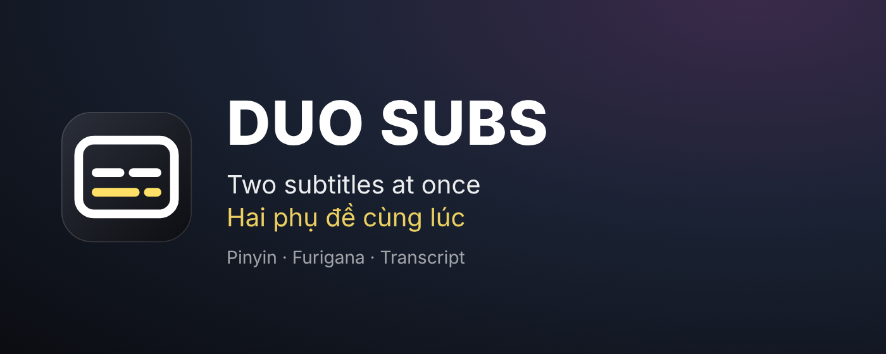

# DUO SUBS – Dual Subtitles for Netflix



Tiện ích Chrome (Manifest V3) hiển thị **2 phụ đề cùng lúc** khi xem phim trên netflix.com (ví dụ tiếng Anh + tiếng Việt), lấy trực tiếp từ các track phụ đề Netflix cung cấp cho phim đó. JavaScript thuần, không framework, không bước build.

**Hướng dẫn sử dụng đầy đủ:** [Tiếng Việt](docs/HUONG-DAN.md) · [English](docs/USER-GUIDE.md). Chính sách quyền riêng tư: [PRIVACY.md](PRIVACY.md).

## Cài đặt

Cách dễ nhất: cài từ Chrome Web Store (link sẽ cập nhật khi được duyệt). Cài thủ công từ mã nguồn:

1. Trên trang [GitHub](https://github.com/thudonggg25/duo-subs-netflix), bấm nút xanh **Code → Download ZIP** rồi giải nén.
2. Mở `chrome://extensions`.
3. Bật **Developer mode** (góc trên bên phải).
4. Bấm **Load unpacked** và chọn thư mục chứa `manifest.json`.
5. Mở (hoặc tải lại) một trang `https://www.netflix.com/watch/...`.

> Nếu tab Netflix đã mở sẵn trước khi cài, hãy **tải lại trang (F5)**: script bắt manifest phải chạy trước khi player của Netflix khởi động.

## Cách dùng

- Rê chuột lên player sẽ thấy **icon phụ đề trắng** ở góc trên bên phải (cùng kiểu icon của Netflix, ẩn cùng thanh điều khiển). Rê chuột vào icon sẽ hiện khung **DUO SUBS**; bấm để mở panel.
- **Bật phụ đề kép**: bật/tắt toàn bộ. Khi bật, phụ đề gốc của Netflix bị ẩn.
- **Phụ đề 1 / Phụ đề 2**: chọn ngôn ngữ hoặc "Tắt". Track chỉ có dạng ảnh được hiện mờ kèm ghi chú "chỉ có dạng ảnh".
- **Kiểu phụ đề 1 / 2**: cỡ chữ, màu chữ, viền hoặc bóng (và màu viền), nền mờ (bật/tắt, màu, độ trong suốt).
- **Kéo thả từng phụ đề riêng lẻ** trên màn hình để đổi vị trí. Khi panel đang mở, phụ đề được chọn hiện chữ mẫu để dễ đặt vị trí.
  - Khi kéo sẽ hiện **đường căn giữa** (dọc và ngang) và toạ độ theo %. Phụ đề tự **hít** vào đường giữa màn hình, thẳng hàng với phụ đề kia, hoặc vị trí cách phụ đề kia đúng một khoảng cố định. Giữ **Alt** khi kéo để tắt hít.
  - **Nhấp đúp** vào phụ đề để căn giữa theo chiều ngang.
- **Đổi cỡ chữ ngay trên màn hình**: rê chuột lên phụ đề (chuột hiện hình mũi tên 2 chiều) rồi **cuộn chuột** để phóng to/thu nhỏ.
- **Bố cục** trong panel:
  - **Tự tránh chồng chữ** (mặc định bật): nếu 2 phụ đề sắp đè lên nhau (ví dụ câu dài 2 dòng), phụ đề không vừa được kéo sẽ tự lùi ra, giữ đúng **khoảng cách** đã chọn.
  - **Né thanh điều khiển**: đẩy phụ đề lên khi thanh điều khiển của Netflix hiện, để thanh tiến trình không che chữ.
- **EN / VIE**: nút ở đầu panel để đổi ngôn ngữ giao diện ngay lập tức (lần đầu tự chọn theo ngôn ngữ trình duyệt).
- Giao diện panel theo phong cách **iOS liquid glass**, bố cục 2 cột (Ngôn ngữ phụ đề | Tùy chỉnh hiển thị), header có logo chữ **52hz**; công tắc, segmented control, slider kiểu iOS với kích thước theo khuyến nghị iOS/Windows. Panel mở ở **góc trên bên phải** (ngay dưới nút DUO SUBS) với kích thước gọn (60% cỡ gốc), nên vẫn nhìn thấy phụ đề trong lúc chỉnh. Muốn đổi độ thu nhỏ, sửa biến `--nds-panel-scale` trong `styles.css`. Khi player hẹp, 2 cột tự xếp thành 1 cột.
- **Tua theo câu**: phím **A** về câu trước, **R** nghe lại câu đang chiếu, **D** tới câu sau. Tua dùng mốc thời gian của Phụ đề 1 (nếu tắt thì dùng Phụ đề 2).
- **Câu thoại song ngữ**: bấm icon danh sách cạnh nút DUO SUBS (hoặc phím **T**) để mở khung câu thoại. Mỗi câu hiện ngôn ngữ của Phụ đề 1 ở trên, Phụ đề 2 (màu vàng) ở dưới; câu đang chiếu được tô sáng và tự cuộn theo phim (tạm dừng vài giây khi bạn tự cuộn). Bấm vào câu nào thì phim tua tới câu đó; 3 nút ở đáy khung làm giống phím A / R / D.
  - **Kéo tiêu đề** để dời khung đi bất cứ đâu, **kéo cạnh hoặc góc** để đổi cỡ tuỳ ý; nhấp đúp tiêu đề để về vị trí mặc định. Vị trí và cỡ được lưu lại.
  - **Nút độ mờ nền** (hình tròn nửa đen): thanh trượt 0–100% chỉnh độ mờ của nền khung.
  - **Chọn ngôn ngữ riêng cho khung**: 2 ô chọn dưới tiêu đề (dòng 1 trắng, dòng 2 vàng). Mặc định "Như Phụ đề 1/2" (theo phụ đề trên màn hình); có thể chọn bất kỳ ngôn ngữ text nào của phim hoặc "Tắt". Ví dụ: màn hình chỉ hiện tiếng Việt để xem cho dễ, còn khung câu thoại vẫn hiện Anh + Việt song song để học.
  - **Tự thu gọn**: sau 2 giây không thao tác, khung ẩn hết nút và ô chọn, chỉ còn khung + chữ (chữ không bị nhảy). Rê chuột vào khung là hiện lại đầy đủ.
  - **Nút tìm kiếm** (kính lúp): gõ từ cần tìm ở cả 2 ngôn ngữ, không cần gõ dấu. Kết quả chia 2 nhóm: **Khớp chính xác** (tô sáng đoạn khớp) và **Câu tương tự** (khớp phần lớn từ, chấp nhận gõ sai 1 ký tự hoặc chỉ gõ đầu từ). Bấm kết quả để tua tới câu đó; Esc để đóng ô tìm.
- **Pinyin trên màn hình**: trong panel, cột Ngôn ngữ phụ đề, dòng **Pinyin** ngay dưới Phụ đề 2 có công tắc bật/tắt (mặc định tắt). Cách hiện tự đổi theo phụ đề đang bật:
  - Chỉ bật phụ đề tiếng Trung → Pinyin hiện thành **dòng phụ đề riêng** (như phụ đề thứ 2).
  - Bật 2 phụ đề, trong đó có tiếng Trung (vd. Việt + Trung) → Pinyin hiện **nhỏ trên từng chữ Hán** của phụ đề tiếng Trung.
  - Không bật phụ đề tiếng Trung nào (vd. chỉ Việt, hoặc Việt + Anh) → Pinyin vẫn hiện thành dòng riêng, lấy từ phụ đề tiếng Trung của phim. Ô chọn cạnh công tắc để chọn bản tiếng Trung (giản thể / phồn thể…), mặc định **Tự động** (ưu tiên giản thể). Phim không có phụ đề tiếng Trung thì panel báo rõ.
  - Dòng Pinyin riêng kéo thả, cuộn đổi cỡ chữ như phụ đề thường; chỉnh cỡ chữ, màu, viền, nền ở tab **Pinyin** trong Tùy chỉnh hiển thị (mặc định màu xanh nhạt, 22px).
- **Furigana (tiếng Nhật)**: tab Phụ đề 1/2 trong Tùy chỉnh hiển thị → **Furigana (tiếng Nhật)** để hiện hiragana trên chữ Kanji (mặc định tắt).
- **Phiên âm trong khung câu thoại**:
  - Nút **拼あ** trên tiêu đề khung bật/tắt Pinyin và Furigana trong khung (mặc định bật).
  - Chỉ áp dụng cho track tiếng Trung (`zh…`, `yue`) và tiếng Nhật (`ja`); ngôn ngữ khác hiện bình thường.
  - Từ điển tiếng Nhật (~17 MB, nằm sẵn trong extension) chỉ được nạp lần đầu cần dùng, mất vài giây; trong lúc đó chữ hiện không phiên âm.
  - Phiên âm do máy tra từ điển nên đôi khi sai với chữ đa âm (nhất là tiếng Trung phồn thể) hoặc tên riêng.
- **Phím tắt Shift+D**: bật/tắt phụ đề kép.
- **Đặt lại mặc định** (cuối cột trái của panel): đưa kiểu chữ, vị trí, bố cục và vị trí/độ mờ khung câu thoại về mặc định (giữ nguyên lựa chọn ngôn ngữ).
- **Chẩn đoán** (dưới nút Đặt lại mặc định): phiên bản, trạng thái bắt manifest, và nguồn của từng phụ đề (track id, định dạng, máy chủ CDN của Netflix).

### Phụ đề có phải bản gốc của Netflix không?

Có. Extension tải thẳng file phụ đề từ URL mà Netflix ghi trong manifest của phim (máy chủ `*.nflxvideo.net`), rồi chỉ parse và hiển thị, **không dịch** gì cả. Mục Chẩn đoán ghi rõ track id và máy chủ của từng phụ đề. Lớp phụ đề cũng được gắn `translate="no"`, nên tính năng tự dịch trang của Chrome không đụng vào được.
- Mọi cài đặt lưu bằng `chrome.storage.local`. Lựa chọn phụ đề được lưu theo **ngôn ngữ**, nên phim/tập sau tự chọn lại đúng ngôn ngữ nếu có.

Mặc định: Phụ đề 1 = tiếng Anh (`en`), Phụ đề 2 = tiếng Việt (`vi`).

## Cấu trúc file

```
netflix-dual-subs/
├── manifest.json            Khai báo MV3, chỉ chạy trên https://www.netflix.com/*
├── README.md
├── PRIVACY.md               Chính sách quyền riêng tư (dùng cho Chrome Web Store)
├── LICENSE
├── icons/                   Icon 16/32/48/128 px
├── docs/                    Hướng dẫn sử dụng + ảnh minh hoạ
└── src/
    ├── background.js        Service worker: tải hộ file phụ đề nếu fetch từ content script bị chặn
    ├── vendor/              Thư viện bên thứ ba (pinyin-pro, kuromoji + từ điển), xem vendor/README.md
    ├── page/
    │   └── interceptor.js   Chạy trong page context (world "MAIN"): hook JSON.stringify/JSON.parse,
    │                        bắt manifest, gửi danh sách track qua window.postMessage
    └── content/             Content script (isolated world), nạp theo thứ tự:
        ├── settings.js      Giá trị mặc định, đọc/ghi chrome.storage.local
        ├── i18n.js          Chuỗi giao diện tiếng Việt / tiếng Anh (NDS.t)
        ├── parsers.js       Parser TTML/DFXP (tickRate, <br/>, span lồng nhau, entity) và WebVTT
        ├── subtitles.js     Tải + cache phụ đề, tìm cue đang hiển thị bằng tìm kiếm nhị phân
        ├── overlay.js       Lớp hiển thị 2 khối phụ đề: kéo riêng + đường căn/hít, tránh chồng chữ, đổi cỡ chữ trên màn hình
        ├── menu.js          Nút nổi + panel cài đặt kiểu iOS liquid glass, nút VIE/ENG
        ├── transcript.js    Khung "Câu thoại" song ngữ, ghép 2 phụ đề theo thời gian
        ├── phonetic.js      Phiên âm Pinyin (pinyin-pro) / Furigana (kuromoji), hiển thị bằng <ruby>
        ├── main.js          Điều phối: SPA, gắn UI vào player/fullscreen, vòng lặp requestAnimationFrame
        └── styles.css       CSS (tiền tố nds-), kèm luật ẩn phụ đề gốc
```

## Cách hoạt động

1. `interceptor.js` chạy ở `document_start` trong page context, trước code của Netflix.
   - Hook `JSON.stringify`: khi Netflix gửi request xin manifest (object có `params.profiles`), chèn thêm các profile phụ đề text (`webvtt-lssdh-ios8`, `dfxp-ls-sdh`, `simplesdh`) và `showAllSubDubTracks = true`.
   - Hook `JSON.parse`: khi kết quả có `movieId` và danh sách track `textTracks` (manifest v4) hoặc `timedtexttracks` (bản cũ), chuẩn hoá từng track (ngôn ngữ, loại, định dạng text tốt nhất, URL) rồi `window.postMessage` sang content script. Ưu tiên TTML (`dfxp-ls-sdh`, `simplesdh`, `imsc1.1`), sau đó WebVTT.
   - Cache manifest theo `movieId` và gửi lại khi content script yêu cầu.
2. `main.js` theo dõi `/watch/<id>` (hook `pushState`/`replaceState`, `popstate` và kiểm tra định kỳ mỗi 0,5 giây). Khi đổi phim/tập, lấy manifest khớp id và chọn lại track theo ngôn ngữ đã lưu.
3. Phụ đề được tải bằng `fetch` từ content script. Nếu bị chặn, `background.js` tải hộ (chỉ cho phép host `*.nflxvideo.net`).
4. Mỗi khung hình, đọc `video.currentTime`, tìm cue đang hoạt động bằng tìm kiếm nhị phân và chỉ vẽ lại khi cue thay đổi.
5. UI được gắn vào container của player; khi fullscreen, gắn vào `document.fullscreenElement` nếu container không nằm trong đó.

## Điểm dễ hỏng khi Netflix thay đổi

Toàn bộ extension dựa trên chi tiết nội bộ của Netflix, không phải API công khai. Khi lỗi, nên kiểm tra theo thứ tự sau:

| Điểm phụ thuộc | File | Dấu hiệu hỏng |
|---|---|---|
| Netflix tạo request/đọc manifest bằng `JSON.stringify`/`JSON.parse` | `interceptor.js` | Panel báo "Đang chờ danh sách phụ đề…" mãi. Có thể phải chuyển sang hook `fetch`/`XMLHttpRequest`. |
| Tên field `params.profiles`, `showAllSubDubTracks` | `interceptor.js` | Chỉ thấy track "chỉ có dạng ảnh" hoặc thiếu ngôn ngữ. |
| Tên field `textTracks`/`timedtexttracks`, `movieId`, `downloadables`/`ttDownloadables`, `downloadUrls` / `urls`, `new_track_id`, `rawTrackType`, `isNoneTrack`, `isForcedNarrative` | `interceptor.js` | Không có track nào hoặc track "không có URL". |
| Tên profile phụ đề (`dfxp-ls-sdh`, `webvtt-lssdh-ios8`, `simplesdh`, `imsc1.1`) | `interceptor.js` | Track bị coi là dạng ảnh. |
| Track chưa "hydrate" (manifest không kèm URL, Netflix tải sau) | `interceptor.js` | Track hiện "không có URL". Cần bắt thêm request tải track riêng. |
| Selector player: `.watch-video--player-view`, `[data-uia="player"]`… | `main.js` | Nút và phụ đề không hiện, hoặc lệch chỗ. |
| Selector thanh điều khiển: `[data-uia="controls-standard"]`, class `active`/`passive` | `main.js` | Nút không ẩn/hiện theo thanh điều khiển (vẫn có dự phòng theo chuyển động chuột). |
| Class phụ đề gốc `.player-timedtext` | `styles.css` | Phụ đề gốc không bị ẩn, hiện chồng lên phụ đề kép. |
| URL `/watch/<id>` khớp `movieId` trong manifest | `main.js` | Sai phụ đề sau khi chuyển tập. Có dự phòng dùng manifest mới nhất trong vài giây sau khi chuyển. |
| CORS của CDN phụ đề | `subtitles.js`, `background.js` | Panel báo "Lỗi tải phụ đề". Kiểm tra host CDN có còn là `*.nflxvideo.net` không. |
| Phím tắt của Netflix nghe ở capture phase | `menu.js` | Gõ phím trong panel làm pause/fullscreen. |
| API player nội bộ `netflix.appContext.state.playerApp.getAPI().videoPlayer…seek(ms)` | `interceptor.js` | Phím A/R/D hoặc bấm câu thoại không tua được (hoặc Netflix báo lỗi khi tua). |
| Netflix dùng thêm phím A, R, D, T | `main.js` | Phím của Netflix bị extension giành mất. |
| Mã ngôn ngữ track (`zh-Hans`, `zh-Hant`, `ja`…) | `phonetic.js` | Không hiện phiên âm dù đã bật. |

Mẹo gỡ lỗi: mở panel và xem mục **Chẩn đoán** ở cuối panel, hoặc mở DevTools trên trang Netflix và gõ `Dual Subs` vào ô Filter của Console.

## Giới hạn

- Không hiển thị được phụ đề dạng ảnh (một số ngôn ngữ như tiếng Nhật, Trung, Hàn, Ả Rập ở một số phim chỉ có dạng này).
- Bỏ qua vị trí/vùng (region) trong TTML: mọi dòng của một phụ đề hiển thị trong cùng một khối.
- Chỉ giữ chữ nghiêng; các định dạng khác (màu, gạch chân) trong file phụ đề bị bỏ qua.
