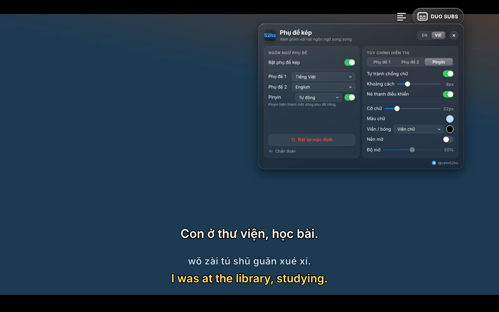
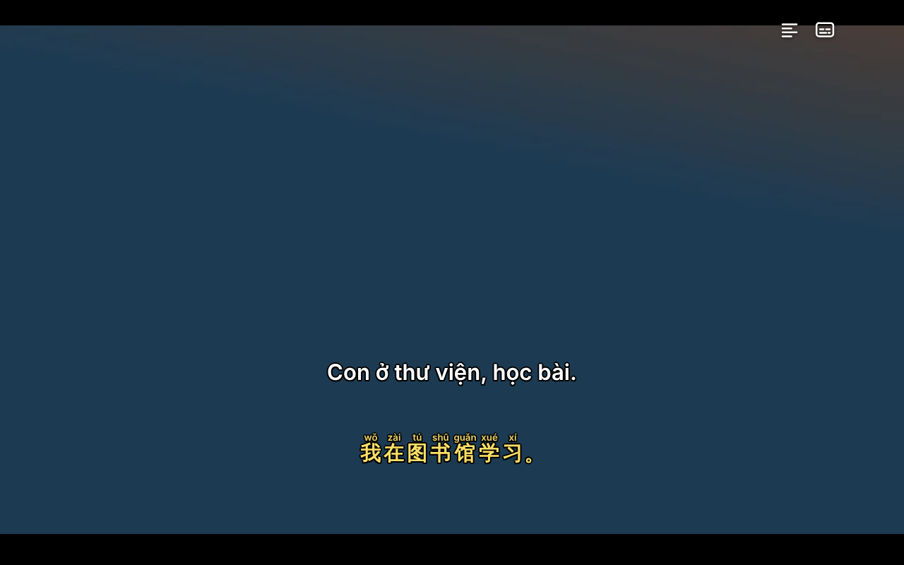
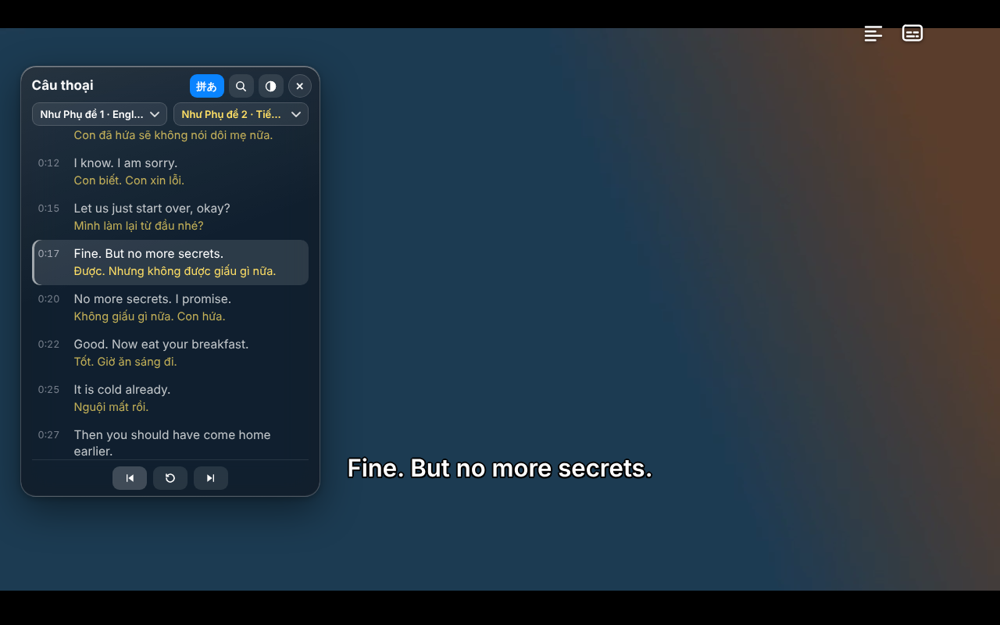

# DUO SUBS – Hướng dẫn sử dụng

## DUO SUBS là gì

DUO SUBS là tiện ích Chrome giúp xem phim Netflix với hai phụ đề cùng lúc, ví dụ tiếng Việt và tiếng Anh, để vừa xem vừa học ngoại ngữ. Phụ đề lấy từ chính các bản phụ đề gốc của Netflix, không dịch máy.

- Hai phụ đề song song, mỗi phụ đề kéo thả và chỉnh kiểu chữ riêng.
- Pinyin cho tiếng Trung, Furigana cho tiếng Nhật.
- Khung câu thoại song ngữ: xem lại cả phim theo từng câu, bấm để tua, tìm kiếm câu thoại.
- Tua theo câu bằng phím A, R, D để luyện nghe.
- Giao diện tiếng Việt hoặc tiếng Anh.

DUO SUBS không thu thập dữ liệu, không cần tài khoản và chỉ chạy trên trang netflix.com.

## Cài đặt

Cách dễ nhất là cài từ Chrome Web Store, tiện ích sẽ tự cập nhật.

**Từ Chrome Web Store**

1. Mở [trang DUO SUBS trên Chrome Web Store](https://chromewebstore.google.com/detail/gaepdhabgfnljejcjiagcflbaekfbigj).
2. Bấm **Thêm vào Chrome**, rồi bấm **Thêm tiện ích**.
3. Mở hoặc tải lại (F5) trang Netflix đang xem.

**Cài thủ công từ file zip** (khi chưa có trên cửa hàng, hoặc muốn dùng bản mới nhất trên GitHub)

1. Vào [trang GitHub của DUO SUBS](https://github.com/thudonggg25/duo-subs-netflix), bấm nút xanh **Code → Download ZIP** và giải nén vào một thư mục cố định, không xóa thư mục này sau khi cài.
2. Mở `chrome://extensions` trên thanh địa chỉ.
3. Bật **Chế độ dành cho nhà phát triển** ở góc trên bên phải.
4. Bấm **Tải tiện ích đã giải nén** và chọn thư mục có file `manifest.json`.
5. Mở hoặc tải lại (F5) trang Netflix.

**Cập nhật:** cuối panel có dòng phiên bản, cho biết bạn đã dùng bản mới nhất hay chưa; khi có bản mới, nút DUO SUBS hiện chấm đỏ.

- Cài từ Chrome Web Store: Chrome tự cập nhật; muốn lên ngay thì bấm **Cập nhật ngay** ở cuối panel.
- Cài thủ công: bấm **Tải bản mới**, giải nén đè lên thư mục cũ, bấm nút tải lại (↻) của DUO SUBS trong `chrome://extensions`, rồi F5 trang Netflix.

## Bắt đầu nhanh

Mở một phim trên Netflix, di chuột để hiện thanh điều khiển, rồi bấm icon phụ đề ở góc trên bên phải (rê chuột vào sẽ hiện chữ **DUO SUBS**).

1. Trong cột **Ngôn ngữ phụ đề**, chọn ngôn ngữ cho **Phụ đề 1** và **Phụ đề 2**. Chọn **Tắt** nếu chỉ muốn một phụ đề.
2. Phụ đề gốc của Netflix tự ẩn đi, thay bằng phụ đề của DUO SUBS.
3. Bấm ra ngoài panel để đóng và xem tiếp.

Lựa chọn ngôn ngữ được nhớ cho các phim sau. Nếu phim không có ngôn ngữ đã chọn, panel sẽ báo. Công tắc **Bật phụ đề kép** (hoặc phím Shift+D) tắt nhanh toàn bộ để quay lại phụ đề thường của Netflix. Nút **EN / VIE** ở đầu panel đổi ngôn ngữ giao diện.

## Tuỳ chỉnh hiển thị

Mọi chỉnh sửa hiện ngay trên phim và được lưu lại. Khi panel mở, phụ đề hiện chữ mẫu để dễ canh vị trí.

**Ngay trên màn hình**

- **Kéo** phụ đề để đổi vị trí. Phụ đề tự hít vào giữa màn hình hoặc thẳng hàng với phụ đề kia; giữ Alt khi kéo để tắt hít.
- **Cuộn chuột** trên phụ đề để phóng to, thu nhỏ chữ.
- **Nhấp đúp** để đưa phụ đề về giữa theo chiều ngang.

**Trong panel, cột Tùy chỉnh hiển thị**

- Chọn tab **Phụ đề 1**, **Phụ đề 2** hoặc **Pinyin** để chỉnh riêng từng dòng: cỡ chữ, màu chữ, viền hoặc bóng, nền mờ và độ mờ.
- **Tự tránh chồng chữ**: khi câu dài xuống dòng, phụ đề kia tự dịch ra; **Khoảng cách** đặt khoảng hở tối thiểu.
- **Né thanh điều khiển**: đẩy phụ đề lên khi thanh điều khiển của Netflix hiện ra.
- **Đặt lại mặc định** (cuối cột trái) đưa kiểu chữ và vị trí về ban đầu, giữ nguyên ngôn ngữ đã chọn.

## Pinyin và Furigana

Bật công tắc **Pinyin** ngay dưới Phụ đề 2 trong panel; cách hiện tự đổi theo phụ đề bạn đang bật.

| Bạn đang bật | Pinyin hiện thế nào |
| --- | --- |
| Chỉ phụ đề tiếng Trung | Thành một dòng phụ đề riêng, như phụ đề thứ hai |
| Hai phụ đề, có tiếng Trung (ví dụ Việt + Trung) | Nhỏ phía trên từng chữ Hán |
| Không có phụ đề tiếng Trung (ví dụ chỉ Việt, hoặc Việt + Anh) | Thành dòng riêng, lấy từ phụ đề tiếng Trung của phim |

- Ô chọn cạnh công tắc dùng để chọn bản giản thể hay phồn thể; mặc định **Tự động** ưu tiên giản thể.
- Dòng Pinyin riêng kéo thả và cuộn đổi cỡ chữ như phụ đề thường; chỉnh màu và cỡ chữ ở tab **Pinyin**.
- Phim không có phụ đề tiếng Trung thì không tạo được Pinyin, panel sẽ báo.

**Furigana** (chữ hiragana trên Kanji tiếng Nhật): chọn tab Phụ đề 1 hoặc 2 và bật **Furigana (tiếng Nhật)**. Lần đầu bật cần vài giây để nạp từ điển.

Phiên âm do máy tra từ điển nên thỉnh thoảng sai với chữ đa âm hoặc tên riêng.

## Khung câu thoại song ngữ

Bấm icon danh sách cạnh nút DUO SUBS (hoặc phím T) để mở khung câu thoại: mỗi câu hiện hai ngôn ngữ trên dưới, câu đang chiếu được tô sáng và tự cuộn theo phim.

- **Bấm vào một câu** để tua phim tới câu đó.
- **Ba nút ở đáy khung**: câu trước, nghe lại, câu sau (giống phím A, R, D).
- **Kéo tiêu đề** để dời khung, **kéo cạnh hoặc góc** để đổi cỡ; nhấp đúp tiêu đề để về vị trí mặc định.
- **Ngôn ngữ riêng cho khung**: hai ô chọn dưới tiêu đề. Ví dụ màn hình chỉ hiện tiếng Việt, còn khung vẫn hiện Anh + Việt để học.
- **Tìm kiếm** (icon kính lúp): gõ từ cần tìm ở cả hai ngôn ngữ, không cần gõ dấu. Kết quả chia thành khớp chính xác và câu tương tự; Esc để đóng.
- **Độ mờ nền**: nút hình tròn nửa đen trên tiêu đề.
- **Nút 拼あ**: bật tắt Pinyin và Furigana trong khung.

Sau 2 giây không thao tác, khung tự thu gọn chỉ còn chữ; rê chuột vào là hiện lại đầy đủ.

## Phím tắt

Phím tắt chỉ hoạt động khi đang xem phim và không gõ trong ô nhập liệu.

| Phím | Tác dụng |
| --- | --- |
| A | Tua về câu trước |
| R | Nghe lại câu hiện tại |
| D | Tua tới câu sau |
| T | Mở hoặc đóng khung câu thoại |
| Shift + D | Bật hoặc tắt phụ đề kép |

## Câu hỏi thường gặp

| Tình huống | Cách xử lý |
| --- | --- |
| Không thấy nút DUO SUBS | Di chuột trên phim để hiện thanh điều khiển; nếu vẫn không có, tải lại trang (F5). |
| Panel báo "Đang chờ danh sách phụ đề" mãi | Tải lại trang khi đang ở trang xem phim. |
| Không có ngôn ngữ mình muốn | Phim đó không có phụ đề ngôn ngữ này trên Netflix ở khu vực của bạn. |
| Ngôn ngữ hiện "chỉ có dạng ảnh" | Phụ đề đó Netflix chỉ cung cấp dạng hình ảnh nên không hiển thị được. |
| Phụ đề không khớp tiếng | Bấm tạm dừng rồi phát lại; nếu vẫn lệch, tải lại trang. |
| Chrome báo "Lỗi" trong trang tiện ích sau khi cập nhật | Xóa thông báo lỗi và tải lại trang Netflix; đó là bản cũ còn chạy trong tab đang mở. |

Khi cần báo lỗi, mở panel, bấm **Chẩn đoán** ở cuối cột trái và chụp màn hình phần đó gửi kèm.

## Quyền riêng tư và liên hệ

DUO SUBS không thu thập, không gửi đi và không bán bất kỳ dữ liệu nào của bạn. Chi tiết: [PRIVACY.md](../PRIVACY.md).

- Cài đặt (ngôn ngữ đã chọn, kiểu chữ, vị trí) chỉ lưu trong Chrome trên máy của bạn.
- Tiện ích chỉ chạy trên netflix.com và chỉ tải file phụ đề từ máy chủ của Netflix (nflxvideo.net).
- Không có quảng cáo, không có tài khoản, không có máy chủ riêng.

DUO SUBS là dự án cá nhân, không liên kết với Netflix. Góp ý và báo lỗi qua Telegram [@calm52hz](https://t.me/calm52hz).
